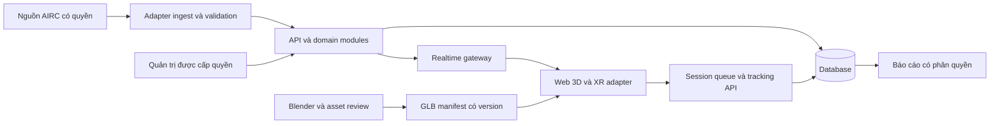

# 09 — Architecture options

> Lịch sử M0-A/M0-B1 được giữ nguyên bên dưới. Cập nhật 14/11/2026: chủ dự án đã duyệt stack/kiến trúc/UI trong M0-B2; xem [ADR-0001 ACCEPTED](decisions/0001-technology-options.md) và [kiến trúc chính thức](12-official-system-architecture.md). Các phát biểu “chưa chọn/PROPOSED” về framework bên dưới mô tả thời điểm nghiên cứu, không phải trạng thái hiện tại. Schema chi tiết/auth/hosting/retention/quyền dữ liệu/KPI cuối/VR acceptance vẫn chưa duyệt.

> Ghi chú lịch sử: nội dung M0-A dưới đây là snapshot trước PoC. M0-B1 nay có adapter/bridge PoC đã chạy; xem [comparison](11-renderer-poc-comparison.md). Kiến trúc/framework/UI sản phẩm vẫn PROPOSED.

**TẤT CẢ KIẾN TRÚC TRONG TÀI LIỆU LÀ PROPOSED.** Chưa có quyết định stack, schema, hosting hay frontend/backend chính thức. Ngày 14/11/2026.

## Sơ đồ module đề xuất

## Hai phương án triển khai

| Phương án | Cấu trúc | Tradeoff cần PoC |
| --- | --- | --- |
| P1 — modular monolith | client tĩnh, một FastAPI ứng viên chứa metadata/state/session/report, PostgreSQL ứng viên, REST + WebSocket | ít vận hành; phải quản lý connection/auth và transaction/ACK đúng; ưu tiên khảo sát cho đồ án |
| P2 — API + polling/SSE | cùng domain modules, REST ghi dữ liệu; polling ngắn hoặc SSE đọc trạng thái | đơn giản hóa luồng một chiều; cadence + network phải chứng minh ≤5 giây; không chốt thay WebSocket trước thử |

Không tách microservices khi chưa có nhu cầu scale. Có thể dùng A hoặc B làm renderer mà giữ domain contract/ID chung. Backend framework/database vẫn chưa duyệt.

## Module và chủ dữ liệu

- `catalog`: room/object/provenance/asset mapping; là điểm cấp stable ID, không để scene tự cấp lại.
- `state`: ba loại trạng thái, version, observed/ingested timestamp và quality; validation trước persist, chỉ role quản trị được ghi.
- `realtime`: publish thay đổi đã commit; cursor/version, reconnect lấy snapshot rồi delta, chống out-of-order; client hiển thị stale khi mất kết nối.
- `experience`: session/event ingestion, dedupe và recovery; không có quyền sửa trạng thái thiết bị.
- `reporting`: truy vấn/xuất theo quyền, redaction và retention; không đưa event định danh vào Git.
- `assets`: manifest version + checksum + bounds/unit/node mapping; domain metadata nằm ngoài mesh, tải theo phòng/LOD sau đo.
- `client`: UI DOM, navigation, renderer adapter, XR input adapter, state cache; không quyết định quyền server.

Một owner tích hợp chịu trách nhiệm contract/version; xác nhận người cụ thể trước triển khai. Không có folder sản phẩm được scaffold ở M0.

## Luồng trạng thái và độ trễ

Nguồn đã xác thực → adapter kiểm tra quyền/schema/provenance → transaction DB → publish version → client áp dụng và render. Thiết kế không được bỏ qua độ trễ nguồn. Cần kiểm tra trường hợp commit thành công nhưng publish lỗi (outbox hoặc reconcile là lựa chọn cần PoC), retry có giới hạn và resync. Đo t_source → t_render với clock offset; báo cả thất bại, không chỉ WebSocket ping.

## Session tracking/recovery

PROPOSED: client tạo event ID ổn định trước enqueue, session ID ngẫu nhiên, sequence và schema version. Durable queue cục bộ nếu có consent; gửi batch giới hạn; server dedupe theo session/event ID, ACK sau persist; xóa queue chỉ khi ACK. Crash/reload/offline có replay cùng ID; snapshot phiên giữ room/view có version, không phục hồi quyền XR tự động. Trang reload cần user gesture mới để vào immersive session. Session token khác admin credential, hết hạn có luồng bắt đầu phiên mới và giải thích.

MT3 cần oracle độc lập để so unique event hợp lệ; proposal “at least once + dedupe” không phải bảo đảm exactly-once đã kiểm chứng. Retention và storage permission cần duyệt; nếu storage bị chặn phải báo không bảo đảm recovery thay vì hứa ngầm.

## Asset lifecycle

Survey được phép → Blender source giữ ngoài repo nếu nhạy cảm/nặng → export GLB/glTF → validator unit/scale/ID/texture/license → revision manifest → tải theo quyền. Không commit mô hình AIRC trước review quyền. Cache key có hash/version; rollback manifest tương ứng catalog version. USDZ cho Quick Look là pipeline fallback riêng, không giả định GLB tương đương tự động.

## Trust boundaries và quyền

Visitor chỉ đọc thông tin được duyệt và ghi event của phiên mình; editor quản lý dữ liệu được phân công; reviewer/exporter xem báo cáo theo quyền. Roles là PROPOSED. Server xác thực mọi write/export, validate object ownership/payload, origin/CSRF khi cookie auth được chọn, rate limit/batch size; TLS khi triển khai được duyệt, secret ngoài Git. Chưa chọn auth provider, retention hay hosting. Không để ID đoán được trở thành quyền truy cập. Log không chứa token/raw input nhạy cảm; cần kế hoạch xóa/export dữ liệu và backup trước lưu dữ liệu thật.

## Điểm phải PoC trước duyệt

Renderer A/B + React bridge, stable ID qua Blender export, Android AR session, XR emulator/reconnect, độ tươi source, realtime rollback/resync, durable queue/dedupe/reload, export ≥50 phiên synthetic, và asset budget cho 30/72 FPS. Tất cả NOT TESTED ở M0-A. [ADR PROPOSED](decisions/0001-technology-options.md) là nơi ghi quyết định sau khi có người duyệt.
