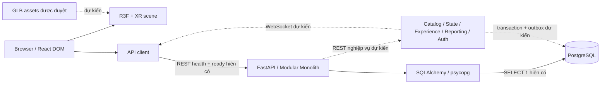

# Kiến trúc hệ thống chính thức — M0-B2

Cập nhật 14/11/2026. Stack và Modular Monolith ACCEPTED theo [ADR-0001](decisions/0001-technology-options.md). Chi tiết module/contract/mô hình dưới đây là thiết kế v1 PROPOSED cho M1, trừ phần foundation thực sự hiện có.

## Cấu trúc và ranh giới

apps/web: app initialization, components/ErrorBoundary, features/catalog/demo adapter, scene renderer, api/client, shared/types, styles, tests. Một màn hình nên chưa cần routing framework. apps/api: application factory, core/config, database/connection, modules/status và tests. experiments giữ nguyên PoC; infra chỉ hạ tầng local. Không có microservices, database business model hoặc module rỗng để giả tính năng.

## Ownership và module dự kiến

| Module | Trách nhiệm | M0-B2 |
|---|---|---|
| Catalog | room/object identity, metadata, asset refs, provenance | chỉ demo adapter ở client; API chưa có |
| State | authoritative state/version/history | chưa triển khai |
| Realtime | subscription, snapshot/delta, reconnect, outbox delivery | chỉ contract |
| Experience | session/event idempotency, consent và persistence | chỉ contract |
| Reporting | aggregate/export theo quyền | chỉ contract |
| Auth | access policy server-side | chưa chọn provider, không có public write |
| Status | live process, dependency readiness | triển khai GET /api/health và /api/ready |

Backend sở hữu dữ liệu đã kiểm chứng, quyền ghi và version; frontend chỉ chọn/xem và trình bày. Không dùng synthetic demo như source of truth AIRC. Sự kiện tương tác tương lai phải đi qua validation/quyền/transaction trước persistence. Retention và consent chưa duyệt, không thu thập event nền trong foundation.

## Luồng chạy hiện có

Vite dev/preview proxy /api đến API loopback (API_PROXY_TARGET chỉ Node-side). Browser kiểm tra health và readiness độc lập về ý nghĩa: liveness 200 không chứng minh DB sẵn sàng; readiness trả 503 với database not_configured/unavailable, 200 chỉ sau SELECT 1. Backend sync readiness chạy threadpool của FastAPI, pool tối đa 2 connection; connect/pool/statement timeout 3 giây, đóng transaction/connection sau probe, dispose khi lifespan dừng. Không DDL hoặc seed.

Frontend timeout API 4 giây, xử lý HTTP/contract/network error, cho kiểm tra lại. API không trả raw exception/credentials. WebGL2 không khả dụng/context lost và React render error có fallback DOM, danh sách vẫn truy cập được; lazy scene có loading riêng. Không tự mở camera/session XR, emulator tắt. XR package được tích hợp nhưng AR/VR thật NOT TESTED.

## Assets, nhiều phòng và bảo mật

Asset pipeline PROPOSED: Blender → GLB đã tối ưu → kiểm quyền/kích thước/hash → manifest versioned theo stable room/object ID → renderer adapter. Không đặt ảnh survey/raw personal data trong Git; asset chỉ công bố khi có quyền. Renderer không hardcode room507; room/object IDs và adapter tách khỏi mesh. M1 sẽ tải phòng theo route/selection, lazy asset và budget riêng từng thiết bị.

Trust boundaries: browser là untrusted; không secrets trong VITE_ hoặc quyền ghi từ client. CORS explicit local origins, credentials false; CORS không phải authentication. Foundation chỉ GET status và OpenAPI, không write nghiệp vụ. PostgreSQL local bind 127.0.0.1:55432 với volume tên dự án; không public exposure, không mount ổ đĩa hoặc xóa volumes. CI PG ephemeral riêng; không dùng dữ liệu thật. HTTPS/auth/rate limits/log correlation/retention cần thiết kế trước production; chưa deploy.

## Giao tiếp dự kiến

REST contracts ở [docs/14](14-api-contracts.md); model ở [docs/13](13-data-model.md). DB transaction sẽ ghi state/history/outbox cùng commit; publisher retry sau commit, client nhận ít nhất một lần và dedupe theo version/event ID. Không triển khai WebSocket/outbox ở M0-B2. Độ trễ ≤5 giây cần instrumentation source→commit→publish→receive→render, đồng bộ clock và báo uncertainty, chưa đo KPI.

## Nguồn và phiên bản kiểm tra 14/11/2026

Giữ React19.3.1, R3F9.8.2, XR6.6.32, Three0.185.0, Vite7.3.8, TS5.9.3; lockfile riêng apps/web. R3F9 tương ứng React19 theo [official introduction](https://r3f.docs.pmnd.rs/getting-started/introduction); [XR introduction](https://pmndrs.github.io/xr/docs/getting-started/introduction); [Vite guide](https://vite.dev/guide/) yêu cầu Node20.19+/22.12+, dự án chọn Node22 >=22.12 <23. Không nâng lên Vite8/R3F10 alpha.

Metadata [PyPI FastAPI](https://pypi.org/pypi/fastapi/json): 0.162.7, 13/11/2026, Python>=3.11, MIT; [uvicorn](https://pypi.org/pypi/uvicorn/json)0.54.0, 25/09/2026, >=3.10, BSD3; [SQLAlchemy](https://pypi.org/pypi/sqlalchemy/json)2.1.8, 04/11/2026, >=3.11, MIT; [psycopg](https://pypi.org/pypi/psycopg/json)3.3.9,12/11/2026, >=3.10, LGPL3; [pydantic-settings](https://pypi.org/pypi/pydantic-settings/json)2.16.3,13/11/2026, >=3.11, MIT. Python3.13 được chọn và kiểm bằng lock/tests. psycopg[binary] mang libpq/binary library licenses riêng; dùng local/CI, rà lại distribution/security trước production.

pytest9.2.0 (27/10/2026,MIT), httpx0.28.1 (06/12/2024,BSD3), ruff0.17.5 (12/11/2026,MIT) khóa cùng dependencies trong requirements.lock có hash; pip-tools7.6.2 (07/10/2026,BSD3) chỉ hỗ trợ tạo lock trong venv. Lock được giải trên Windows/Python3.13 và kiểm cài lại trên Linux CI; platform packages phải review nếu thêm platform mới. Không dependency global.

[FastAPI lifespan](https://fastapi.tiangolo.com/advanced/events/), [CORS](https://fastapi.tiangolo.com/tutorial/cors/), [SQLAlchemy engine](https://docs.sqlalchemy.org/en/21/core/engines.html), [psycopg binary installation](https://www.psycopg.org/psycopg3/docs/basic/install.html) là cơ sở API triển khai. [PostgreSQL docs](https://www.postgresql.org/docs/) xác minh stable18.7,12/11/2026, PostgreSQL License; không chọn19 RC. [Alembic tutorial](https://alembic.sqlalchemy.org/en/latest/tutorial.html)/[PyPI metadata](https://pypi.org/pypi/alembic/json)1.20.1,22/10/2026,Python>=3.10,MIT: tương thích SQLAlchemy nhưng chưa cài hoặc tạo revision vì schema chưa duyệt. Mọi nguồn trong mục này truy cập14/11/2026; kết quả CI ở acceptance là bằng chứng compatibility thực tế, metadata không thay test.

Official Actions kiểm lại 14/11/2026 bằng GitHub tag API: [checkout v7.0.1](https://github.com/actions/checkout/releases/tag/v7.0.1), [setup-node v7.1.0](https://github.com/actions/setup-node/releases/tag/v7.1.0), [setup-python v7.1.0](https://github.com/actions/setup-python/releases/tag/v7.1.0), [upload-artifact v7.0.2](https://github.com/actions/upload-artifact/releases/tag/v7.0.2). SHA trong workflow trùng tag; permissions contents:read, không secrets/deploy/write. Đây là baseline kế thừa workflow M0-B1, không thêm action bên thứ ba.
