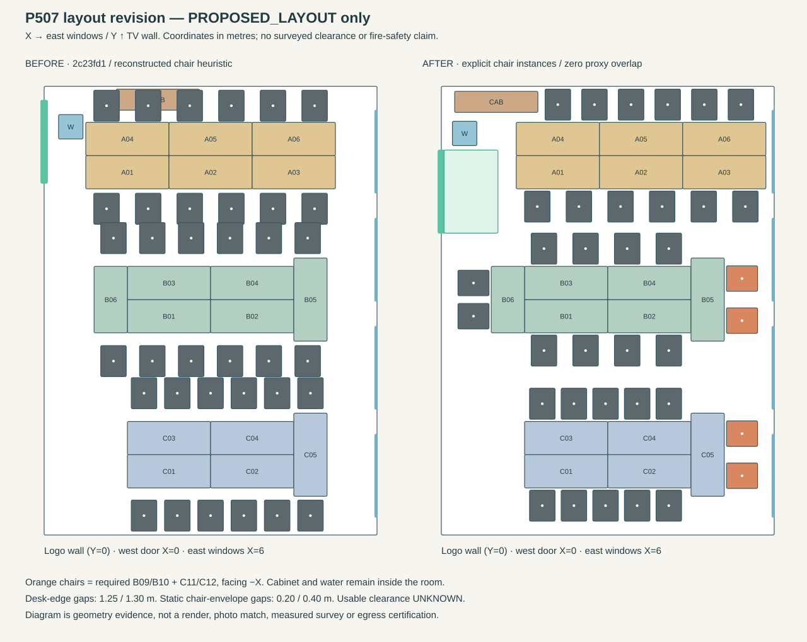

# P507 G1/G2 — layout correction and hero revision

16/11/2026 · PR #14 · `feat/p507-g1-g2-blockout-hero` → `docs/g0-p507-3d-production-spec`. No merge/deploy/G3. This revision supersedes the earlier desk-only geometry verdict; G0 is unchanged.

## Layout and occupancy

All coordinates below are **PROPOSED_LAYOUT**, survey XYZ metres. Room stays 6 × 8.1 × 3.5. A translates +0.60 X only; B/C desk coordinates are preserved.

| ID | xmin | ymin | xmax | ymax |
| --- | ---: | ---: | ---: | ---: |
| P507-DESK-A01 | 1.35 | 6.25 | 2.85 | 6.85 |
| P507-DESK-A02 | 2.85 | 6.25 | 4.35 | 6.85 |
| P507-DESK-A03 | 4.35 | 6.25 | 5.85 | 6.85 |
| P507-DESK-A04 | 1.35 | 6.85 | 2.85 | 7.45 |
| P507-DESK-A05 | 2.85 | 6.85 | 4.35 | 7.45 |
| P507-DESK-A06 | 4.35 | 6.85 | 5.85 | 7.45 |
| P507-DESK-B01 | 1.50 | 3.65 | 3.00 | 4.25 |
| P507-DESK-B02 | 3.00 | 3.65 | 4.50 | 4.25 |
| P507-DESK-B03 | 1.50 | 4.25 | 3.00 | 4.85 |
| P507-DESK-B04 | 3.00 | 4.25 | 4.50 | 4.85 |
| P507-DESK-B05 | 4.50 | 3.50 | 5.10 | 5.00 |
| P507-DESK-B06 | 0.90 | 3.65 | 1.50 | 4.85 |
| P507-DESK-C01 | 1.50 | 0.85 | 3.00 | 1.45 |
| P507-DESK-C02 | 3.00 | 0.85 | 4.50 | 1.45 |
| P507-DESK-C03 | 1.50 | 1.45 | 3.00 | 2.05 |
| P507-DESK-C04 | 3.00 | 1.45 | 4.50 | 2.05 |
| P507-DESK-C05 | 4.50 | 0.70 | 5.10 | 2.20 |

A bbox `[1.35,6.25,5.85,7.45]`; B `[0.90,3.50,5.10,5.00]`; C `[1.50,0.70,5.10,2.20]`. B01–04/C01–04 retain 2×2 cores; B05/C05 are longitudinal right ends; B06 remains provisional 1.20 × 0.60 × 0.90.

| Right-end chair | Centre X,Y | Facing | Desk |
| --- | --- | --- | --- |
| P507-CHAIR-B-09 | `[5.42, 3.87]` | 90° / −X | P507-DESK-B05 |
| P507-CHAIR-B-10 | `[5.42, 4.63]` | 90° / −X | P507-DESK-B05 |
| P507-CHAIR-C-11 | `[5.42, 1.07]` | 90° / −X | P507-DESK-C05 |
| P507-CHAIR-C-12 | `[5.42, 1.83]` | 90° / −X | P507-DESK-C05 |

All 36 stable old chair IDs remain in explicit `chairs.instances`; all 36 are placed provisionally in this revision. The preview reports placed/unplaced counts and IDs; no chair is hidden to conceal collisions. Orientation 0° faces +Y, 90° faces −X; backs are on local −Y.

Door moves from Y=6.35…7.85 to **5.45…6.95** (−0.90m), preserving 1.50 × 2.50m provisional opening. Entry zone is X=.05…1.02 over that interval. Cabinet `P507-CABINET-LOW` centre is **[.99,7.82,.38]**, full detailed proxy [.20,7.59,1.78,8.03]. Water `P507-WATER-DISPENSER` centre is **[.42,7.25,.55]**, proxy [.18,7.00,.66,7.50], inside the west/TV corner, separated from the door. Machine/bottle detailing is authored provisionally; no measured door leaves/swing are invented. The open frame/reveal has a genuine wall void.

Desk-edge gaps A–B/B–C remain **1.25/1.30m**; fixed occupied chair-envelope gaps are only **.20/.40m**. These are narrow static geometrical separations, **not usable/safe passage widths**. Pullout, people, accessibility, door swing and unpositioned utility furniture remain UNKNOWN. This arrangement must not be accepted as a surveyed circulation plan.

## Data and validation

Schema v2 replaces the renderer heuristic with explicit ID, cluster, status, centre, orientation, footprint, role, source_kind and position_source per chair. v1 is still readable: known IDs migrate with **UNPLACED/UNKNOWN** chair poses, never reconstructed into false measurements. The original v1 fixture remains a compatibility test. Existing IDs do not change when positions move; generic objects and additional chairs can be appended without an object-count ceiling. Baseline 17-desk/core invariants are deliberate survey acceptance rules, not a system capacity limit.

Convex SAT rejects positive-area overlap for desk/chair seat+back proxies, cabinet/water, positioned generic large furniture, room inner boundaries and entry rectangle. Intended edge contact is allowed. Supported decoration requires a matching support ID and vertical level; generator respects bottom_z. Unknown utility shelving/cabinets/fridge/shoe rack are listed UNPLACED rather than falsely certified. Blender independently measures evaluated mesh bounds against every placed proxy and checks west walls do not fill the door. The former generator’s actual cabinet–A08 overlap is retained as a failing regression fixture.

## Hero art and reuse

TV now has layered rear casing, mount, narrow bezel, standby detail and dark glass. Cabinet has recessed floor plinth, pale self-authored wood carcass, counter, three doors, standoffs/pulls and anonymous supported display shapes. Water unit has curved PET bottle with shoulder/neck/ribs, collar, separate enclosure, recessed tap area, buttons and drip tray. Tables have relieved laminate edges, steel apron/legs and feet. Chairs use a curved moulded back and tubular steel supports/legs; one linked mesh module is reused across instances. Per-asset joining and shared chair geometry reduce object/draw overhead while keeping IDs. Ceiling grid is light enamel.

Only self-authored neutral procedural tiles/wood and generated geometry are embedded. No downloaded textures, source photographs, authentic artwork, people, screen content or AIRC branding are included. Source/license: repository-authored procedural assets, redistribution with repository; AIRC rights remain PENDING. Blender lookdev lamps are separate from Three.js daylight, panel fill, environment reflections and soft contact shadows.

**Visual judgment:** improved silhouette/detail and layout visibility relative to baseline, but still a simplified procedural architectural study. Wall dressing is neutral and materials lack measured reference detail. Do not call it photorealistic complete or art-approved. Owner must inspect desktop/mobile HERO, wide aisle, top-down and B/C shots. Camera FOV/height and raw software-WebGL metrics are in browser-report.json. PHOTO_MATCH BLOCKED: no authorized local reference images were supplied to this run. No 1:1 match is claimed.

## Evidence and reproduction

Run geometry.py + `python -m unittest discover -s experiments/p507-g1-g2 -p test_geometry.py -v`; Blender `--background --python-exit-code 1 --python experiments/p507-g1-g2/generate_blender.py -- --output-dir .local/p507-g1-g2`; `node experiments/p507-g1-g2/validate_glb.mjs`; frontend build/tests; `node experiments/p507-g1-g2/browser_preview.mjs`. Blender must be available; validator stays a pinned local tooling dependency. Set CHROME_BIN on Windows.

Ignored `.local/p507-g1-g2/` contains editable .blend, GLB, geometry-report.json, report.json (input hashes and measured Blender bounds), gltf-validation-report.json, browser-report.json (raw frame intervals, exact source/checkout SHA, GPU/browser, viewports, bytes/hash and memory estimates) and actual screenshots. CI uploads the same neutral outputs for 7 days. Baseline artifacts were obtained from run **43805152850** at `2c23fd142331349001c7ec0e3a0fd0bed56abb73`; old screenshots/metrics must not be attributed to new HEAD. Final exact HEAD/run IDs and artifact links are in the PR handoff; verify live.

Local source checks: 31 geometry tests, actual Blender4.5.9 export + evaluated bounds, Khronos validator, frontend build/25 tests, checker10 tests, repository verifier and diff/privacy scan. Final CI results are reported only after the final HEAD run completes. Existing frontend large-bundle warning remains. CI software render timings are not physical GPU/mobile/WebXR performance. Before/after screenshots must label whether cameras/lighting match; raw old and current cameras are recorded, not presented as pixel regression.

| Review axis | Status |
| --- | --- |
| G1_GEOMETRY | PASS for placed proposed occupancy; unknown objects excluded explicitly |
| G1_SURVEY_ACCURACY | PROVISIONAL |
| G2_PIPELINE | Final exact-HEAD CI must complete before handoff |
| G2_VISUAL | PENDING OWNER APPROVAL |
| PHOTO_MATCH | BLOCKED |
| REAL_DEVICE_WEBXR | NOT RUN |
| REAL_AIRC_DATA | NOT VERIFIED |
| G3 | NOT STARTED |

Next: ChatGPT/project owner inspect actual renders and decide visual acceptance. Stop here; no merge, deploy, retarget or G3.
