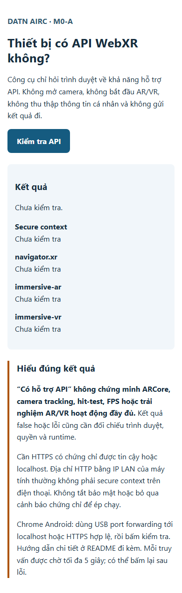

# Bằng chứng M0-A — review fixes PR #6

Cập nhật 14/11/2026. Bản gốc được review: `cdf43fd8a64925a4466685d17456211be18812c1`. Kết quả dưới đây là chạy mới sau sửa P1–P4, không dùng kết quả cũ để báo PASS cho runner mới. Chưa merge, không triển khai sản phẩm hoặc M1.

## Môi trường và regression local

Windows 11; Python 3.13.2; Node 22.16.0; Chrome/157.0.8103.51 headless, GPU disabled. Timestamp thực tế trong [report schema v2](browser-smoke.json), múi giờ +07:00. Không lưu hostname, profile cá nhân hay dữ liệu duyệt web.

| Kiểm tra | Expected | Actual / kết quả |
| --- | --- | --- |
| Node syntax cho checker và toàn bộ JS/CJS tests/driver | không lỗi cú pháp | PASS |
| `node --test tools/webxr-capability-check/tests/checker.test.cjs` | 10 unit/DOM tests thành công | PASS 10/10, chạy lại trên bản sửa |
| `python -m compileall -q tools` | mọi Python file compile được | PASS |
| `python -m unittest discover -s tools/webxr-capability-check/tests -p test_runner.py -v` | discovery/override/cleanup đúng | PASS 8/8, có nhánh Windows/POSIX mock |
| `python tools/webxr-capability-check/tests/run_browser_smoke.py` | hoàn tất native/mock/responsive, cleanup đúng | PASS, xem JSON từng scenario |
| CHROME_BIN trỏ file không tồn tại | exit 2, NOT RUN, không khởi tạo browser | đúng expected; [report NOT RUN](browser-not-run.json) |
| Repository verifier | link nội bộ hợp lệ, UTF-8/PNG allowlist, không trúng mẫu secret | chạy trước commit; kết quả hồi quy ghi trong bàn giao |
| Diff whitespace và rà soát file | không whitespace lỗi, không profile/cache/secret | kiểm tra trước mỗi push; đối chiếu PR checks |
| Logic checker sản phẩm so với commit review | không đổi | `git diff cdf43fd -- tools/webxr-capability-check/checker.js` không có thay đổi |

## Browser report tái lập

- **Native browser — PASS về hành vi utility:** secure context có, navigator.xr có, immersive-ar và immersive-vr trả “API báo không hỗ trợ mode này”; UI hoàn tất và nút bật lại. Không suy ra khả năng của Galaxy/iPhone/kính.
- **Mocked XR — PASS về nhánh xử lý:** AR reject NotAllowedError, VR true; kết quả hiển thị độc lập. Mock true không là bằng chứng phần cứng.
- **Viewport emulation — PASS:** 390×900 CSS px, `innerWidth=390`, `scrollWidth=390`; ảnh chụp trang checker ở trạng thái ban đầu, không giả là ảnh Galaxy. Không mở camera/session để làm bằng chứng.
- Cleanup thực tế: browser_stopped, server_closed, temporary_profile_removed đều true. Unit tests còn kiểm tra fallback chỉ nhắm PID do runner sở hữu; không thử kill browser cá nhân.

PNG thật do Chrome CDP chụp, khoảng 52 KB, đã xem và chỉ có UI checker. Verifier chỉ cho phép PNG đúng đường dẫn này, signature/width/giới hạn 200 KB; không bỏ qua mọi file binary. Report và screenshot được copy có chủ đích vào docs/evidence để review; profile/cache/stderr vẫn ở `.local/` ignored và không upload. CI artifact riêng không ghi đè evidence đã commit.

## Runner portable và thời hạn

[README tái lập](../../tools/webxr-capability-check/README.md) có lệnh Windows/Linux, CHROME_BIN/PATH/common-path discovery, exit 0/1/2. Python stdlib + Node >=22 built-in WebSocket/CDP, không npm dependency hoặc tải browser. Local server và remote debugging chỉ loopback. Profile riêng tạm dưới workspace; startup deadline 15s, Node driver deadline 65s và deadline riêng cho CDP/scenario. finally đóng server/thread, Browser.close khi driver hoàn tất, fallback kết thúc process tree được runner tạo và xóa profile tạm. Không dùng virtual-time-budget ở runner mới.

Windows đã thử thực tế. Linux sẽ được xác minh qua job GitHub browser nếu browser có sẵn; chưa lấy test mock PATH làm bằng chứng Linux runtime PASS. Thiếu runtime báo NOT RUN/exit 2 với expected/actual, không có PASS giả. Một browser bị lỗi startup/driver hoặc cleanup là FAIL, không bị che bởi cơ chế skip.

## GitHub Actions

[Workflow](../../.github/workflows/m0-validation.yml): pull_request vào main và push docs/m0-foundation; hai job Ubuntu 24.04, Node 22/Python 3.13. Chỉ `contents: read`, checkout không giữ credentials; SHA pin action stable theo [sổ nguồn](../research/sources.md). Không secrets riêng, pull_request_target, write permission, auto-commit/merge hoặc deploy.

Job validation: JS syntax, Node unit/DOM, Python syntax, runner unit tests, verifier và diff whitespace toàn nhánh so với origin/main. Job browser: chạy browser có sẵn; absence xuất warning/NOT RUN và report, lỗi thật exit 1 làm FAIL. Upload allowlist đúng `.local/browser-smoke/result.json` và `checker-390.png`, retention 14 ngày; không upload profile/cache/stderr. GitHub chạy thật sẽ được theo dõi sau push và ghi URL/kết luận riêng, không suy PASS từ YAML local.

YAML local đã parse bằng PyYAML 6.0.3 tại `.local/validation-deps`; kiểm tra hai trigger, hai Ubuntu jobs, permission read và không pull_request_target. Thư viện này không là dependency runner/sản phẩm và không commit. GitHub parse/run mới là bằng chứng CI thực tế.

## NOT RUN và blocker không đổi

Galaxy A17 5G, iPhone, VR emulator và kính thật: NOT RUN / thiết bị vật lý NOT TESTED. Latency, FPS, recovery/99% event, ≥50 phiên và ≥15 người: NOT RUN vì chưa có sản phẩm/dataset/thiết bị. Không có benchmark hoặc AR/VR phần cứng PASS.

Theo trao đổi mới do người dùng cung cấp: giảng viên cho biết hiện chỉ phòng 507; anh Quang có thể hỗ trợ inventory sau khi chọn phòng và cho biết chưa có phần mềm quản lý thiết bị. Đây chưa phải khảo sát hoặc xác nhận scope chính thức. Issues #1/#2/#3 vẫn BLOCKED, #4/#5 vẫn mở; KPI ≥3 phòng giữ nguyên. Nhập tay qua admin chỉ PROPOSED, không triển khai.

## Lịch sử bằng chứng

Bản cdf43fd dùng Windows path cố định, browser --dump-dom/virtual time và native timeout; ảnh 390px khi đó chỉ ở .local. Các hạn chế này là lý do review fixes, không bị viết lại thành test tốt ngay từ đầu. Report hiện tại thay thế report cũ cho runner mới; xem Git history để đối chiếu. Workspace/root/remote và head ban đầu đã xác minh đúng AIRC, sạch, bằng commit review; không truy cập dự án cấm.
